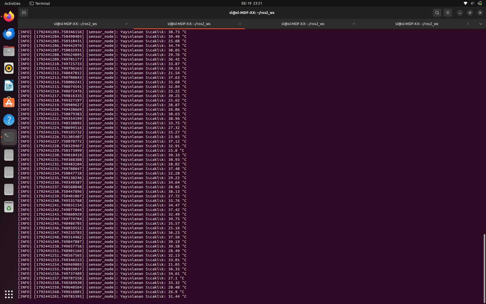
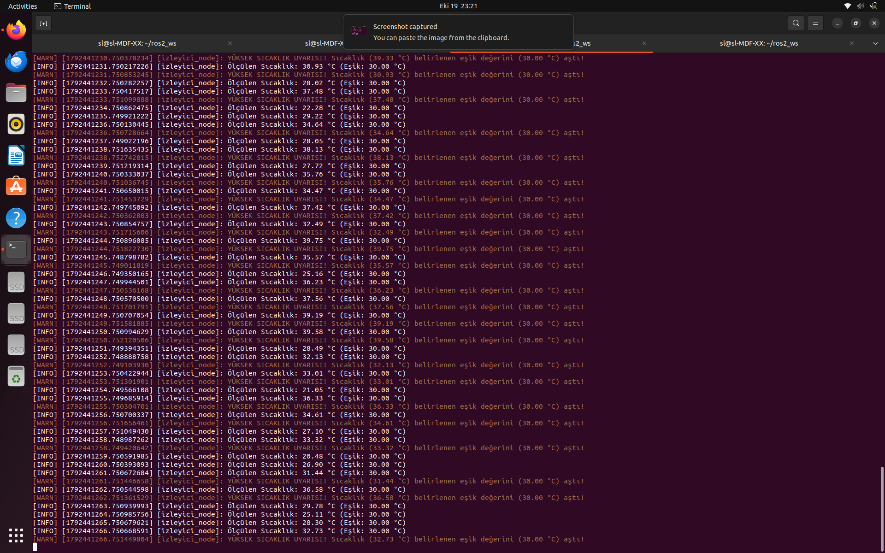
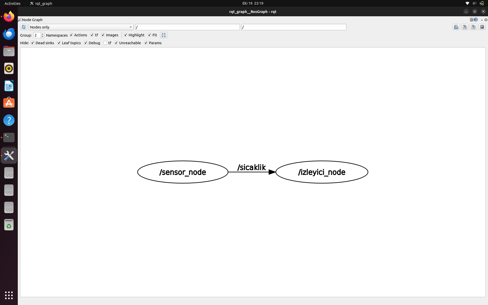

# Sıcaklık İzleyici ROS 2 Paketi (`sicaklik_izleyici_py`)

**Özet—** Bu çalışmada, ROS 2 (Robot Operating System) mimarisi üzerinde `rclpy` ve `std_msgs` kütüphaneleri kullanılarak bir yayıncı-abone (Publisher-Subscriber) haberleşme sistemi tasarlanmıştır. Sistem, rastgele ortam sıcaklığı verisi üreten bir sensör düğümü ile bu verileri işleyip 30 °C eşik değer kontrolü yapan bir izleyici düğümden oluşmaktadır.

---

## 1. Sistem Mimarisi ve Düğüm Tanımları

### A. Sensör Düğümü (`sensor.py`)
`sensor_node` adlı düğüm, her 1 saniyede bir 20.0 - 40.0 °C aralığında rastgele float türünde sıcaklık verisi üretir ve bu veriyi `/sicaklik` konusuna (`std_msgs/msg/Float32`) yayınlar.

### B. İzleyici Düğümü (`izleyici.py`)
`izleyici_node` adlı düğüm, `/sicaklik` konusunu dinleyerek ölçülen veriyi konsola yazdırır. 

* **Dinamik Parametre & Eşik Kontrolü:** Düğüm üzerinde `declare_parameter` ile `esik_sicaklik` parametresi tanımlanmıştır (Varsayılan: `30.0 °C`). Anlık sıcaklık değeri 30.0 °C'yi aştığında sistem `get_logger().warn()` fonksiyonu aracılığıyla terminalde sarı renkli uyarı günlüğü (warning log) oluşturur.

---

## 2. Deney Verileri ve Ekran Çıktıları

### A. Sensör Yayıncısı Çalışma Anı
Sensör düğümü çalıştırıldığında ürettiği sıcaklık verilerini 1 Hz frekansında yayınlamaktadır.


* **Şekil 1:** `sensor` düğümünün terminal ekran çıktısı. Rastgele üretilen sıcaklık verilerinin `/sicaklik` konusuna aktarımı görülmektedir.

---

### B. İzleyici ve Eşik Değer Kontrolü (30 °C)
İzleyici düğüm verileri anlık alarak işler. Sıcaklık 30.0 °C eşik değerini geçtiğinde sistem sarı renkli uyarı mesajı üretmektedir.


* **Şekil 2:** `izleyici` düğümünün terminal çıktısı. Ölçülen sıcaklık 30.0 °C değerini aştığında tetiklenen `WARN` günlüğü gösterilmektedir.

---

## 3. RQT Graph ile Düğüm Haberleşme Analizi

ROS 2 grafiği incelendiğinde `sensor_node` ve `izleyici_node` düğümlerinin `/sicaklik` konusu üzerinden yönlü bir haberleşme kurduğu doğrulanmıştır.


* **Şekil 3:** Sistem bileşenlerinin `rqt_graph` aracıyla elde edilen haberleşme grafiği.

---

## 4. Kurulum ve Çalıştırma Adımları

```bash
# 1. Derleme ve Ortam Tanımlama
cd ~/ros2_ws
colcon build --packages-select sicaklik_izleyici_py
source install/setup.bash

# 2. Sensör Düğümünü Çalıştırma
ros2 run sicaklik_izleyici_py sensor

# 3. İzleyici Düğümünü Çalıştırma
ros2 run sicaklik_izleyici_py izleyici
